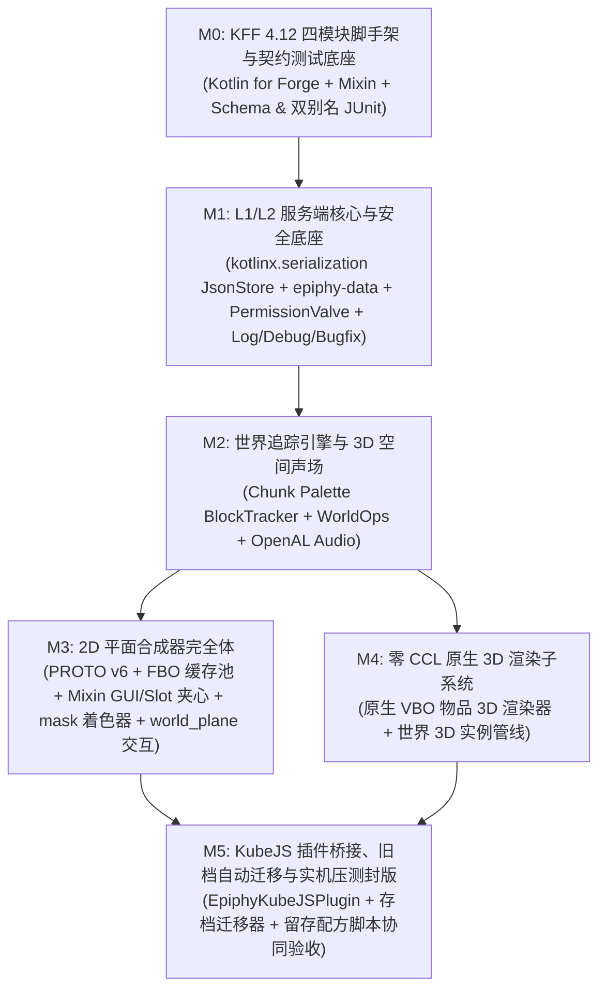

# Epiphy 独立原生模组（Kotlin + Java · Phase 4）迁移工程计划书

> **文档状态**：Phase 4 原生化工程蓝图与架构实施计划（v1.5）  
> **许可证声明 (License)**：本文件适用 RAL-1.6 (Reciprocal Attribution License 1.6 / 相互开源署名许可证 1.6)  
> **前置基线**：KubeJS 过渡期 `P0 ~ P3` 全量里程碑已封版（15 个通用组件、74/74 回归单测、[`docs/proto_v6_schema.json`](proto_v6_schema.json) `v6.3.0`）  
> **关联文档**：[`README-LLM.md`](../README-LLM.md) · [`docs/rendering-subsystem-roadmap.md`](rendering-subsystem-roadmap.md)

---

## 1. 迁移总目标、职责边界、核心铁律与技术栈选型

随着 `P3-1`（`surface: 'world_plane'`）与 `P3-2`（`Epiphy3DFX` & `EpiphyItem3DRenderer`）双端闭环落地，Epiphy 在 KubeJS 原型验证阶段的全部架构探路与协议收敛均已完成。进入 **Phase 4（独立原生 Mod 阶段）** 的核心目标不是把仓库内所有 `.js` 脚本机械翻译为字节码，而是**按职责科学切分「原生引擎层」与「KubeJS 数据魔改层」，保留已验证的声明式契约与安全边界，彻底卸除 Rhino 解释器与第三方渲染胶水限制，解锁原生字节码与 GPU 硬件级管线能力**。

### 1.1 四条不可动摇的工程铁律
1. **能力导向与零案例倒灌铁律**：严格遵循 **【通过什么（底层机制）➔ 能够达成什么（通用能力）➔ 下游案例（具象应用）】**。核心引擎模块（`epiphy-core`）只提供正交原语、协议调度、渲染管线与可扩展注册表，**物理严禁包含任何特定整合包道具、Boss 或测试玩法代码**。
2. **职责得当边界（单纯合成表等数据魔改留存 KubeJS，无需移植）**：
   - **迁入原生 Mod 的范畴**：15 个通用基础底座与双端视听引擎（日志、核心存储、权限阀、调试、Bugfix、区块追踪与地形批处理、2D 平面合成、世界/物品 3D 渲染、3D 空间音频）以及依赖高频 tick 状态机或底层渲染钩子的核心机制；
   - **明确不移植、继续留在 KubeJS 的范畴**：**单纯的【合成表增删改】**（如现行 `kubejs/server_scripts/合成表-*/` 下的原版、植物魔法、神秘遗物配方脚本 `ServerEvents.recipes`）、整合包级物品/方块 Tag 微调、战利品表调整、简单静态 Tooltip 文案补充等纯数据层胶水。此类功能天然契合 KubeJS 的声明式脚本与 `/reload` 热重载工作流，硬编码进编译态 Mod 只会丧失调参灵活性并无谓引入具体内容 Mod 依赖。
3. **核心零业务第三方前置铁律（仅依赖 Forge + `Kotlin for Forge` + `MixinBooster` 现代字节码底座）**：原生 Mod 本体仅以 `Minecraft 1.20.1`、`Forge 47.2+`、官方语言加载器 **`Kotlin for Forge` (`kotlinforforge 4.12.0+`)** 与现代字节码换芯底座 **`Sinytra MixinBooster` (`org.sinytra.mixinbooster:mixin-booster`)** 为运行前置（**彻底告别 LexForge 残缺的 `Sponge Mixin 0.8.5`**，直接对齐 1.21+ NeoForge 原生内置的 `Fabric Mixin` + `MixinExtras` 标准；严禁自行 Jar-in-Jar 重复打包 `kotlin-stdlib`）。KubeJS 阶段在物品 3D 渲染中临时借用的 `CodeChickenLib` 特例将在原生 Mod 中 **100% 移除并自主实现**；`ModernUI`、`Curios API`、`KubeJS` 全部作为编译期 `compileOnly` + 运行期 `ModList.get().isLoaded(...)` 物理隔离的可选软兼容桥接。
4. **语义收敛与官方别名上限规范（保留至多 `2` 个官方别名）**：正式移除过渡期冻结的历史无序淘汰表（`DEPRECATED_DANMAKU_ALIASES`、`DEPRECATED_PRIORITY_ALIASES` 及早期十余种混杂枚举），全模块统一执行 **「1 个主标准名 + 至多 2 个显式官方别名（合计至多 3 个高频名称）」** 规范——所有官方别名均在 API/DSL/JSON 入口单点归一化为主标准名，内部管线与网络二进制帧零别名。

### 1.2 构建与语言分工选型
| 维度 | 选型方案 | 选型依据 |
| :--- | :--- | :--- |
| **目标平台与语言加载器** | `Minecraft 1.20.1` · `Forge 47.2.x` · **`Kotlin for Forge 4.12.0+`**（内置 `neoforge` 过渡包，预留 1.21 演进边界） | 与本地实机测试端（已装 `kotlinforforge-4.12.0-all.jar`）100% 对齐；直接复用 KFF `4.12.0` 语言提供器内建的 **`Kotlin 2.2.21`**（`@Metadata(mv = [2, 2, 0])`）、**`kotlinx-coroutines-core 1.10.2`** 与 **`kotlinx-serialization-json 1.9.0`** |
| **JDK、Gradle 与映射** | `Java 17` + `Gradle 8.8+` + `ParchmentMC 1.20.1` + `ForgeGradle [6.0,6.2)` | 编译期 Mojmap + 参数名可读，发布构建自动重映射 SRG，彻底告别 KubeJS 阶段手动双探 `m_xxxx_` / `f_xxxx_` 的反射脆弱性 |
| **Kotlin + Java 混编分工** | **Kotlin (`2.2.21`，严格对齐 KFF `4.12.0` 运行时 ABI)**：`@Mod object` 单例入口、`@Serializable` 数据模型、`ui {}`/`fx {}` 类型安全 DSL、服务端调度状态机、权限域树与 KubeJS 插件桥接<br>**Java 17**：全部 Mixin 类、OpenGL / `BufferBuilder` / VBO 紧凑字节流写入、每帧零装箱热路径矩阵运算 | `kotlin("plugin.serialization")` 编译器插件版本必须与 KFF `4.12.0` 内置的 `kotlinx-serialization 1.9.0`（Kotlin `2.2.21` 代际）严格一致，防止 `@Serializable` 合成体在运行期发生 `IncompatibleClassChangeError` / `NoSuchMethodError`；同时兼顾 Java 在底层渲染热路径与 Mixin 织入上的绝对确定性 |
| **字节码注入** | **`Sinytra MixinBooster` (`Fabric Mixin 0.15+`)** + **`MixinExtras` (`jarJar`)** | 彻底替换 LexForge 自带的残缺 `Sponge Mixin 0.8.5`，完整解锁接口注入、构造器 `super()` 前注入、匿名内部类修复及 `@WrapOperation` / `@Local` / `@Share`，且代码与未来 1.21+ NeoForge 100% 零修改对齐 |

---

## 2. 基于 `Kotlin for Forge` (`4.12.0`) 的开发模板与实现规范

经对实机环境 `kotlinforforge-4.12.0-all.jar` 的字节码与元数据逐项拆包取证：
- KFF `4.12.0` 外层为 `FMLModType: LIBRARY` 语言库，内嵌 **`kfflang-4.12.0.jar`**（`IModLanguageProvider` 语言加载器）、**`kfflib-4.12.0.jar`**（Forge Kotlin 扩展库）与 **`kffmod-4.12.0.jar`**（容器生命周期绑定）；
- 其内置运行时精确版本为：**`kotlin-stdlib 2.2.21`**（`kotlin/KotlinVersionCurrentValue.class` 的 `get()` 字节码硬编码 `new KotlinVersion(2, 2, 21)`，`META-INF/kotlin-stdlib.kotlin_module` 版本头为 `[2, 2, 0]`）、**`kotlinx-coroutines-core 1.10.2`**（`META-INF/kotlinx_coroutines_core.version`）与 **`kotlinx-serialization-json 1.9.0`**。

工程搭建必须严格遵循以下经字节码核验的 KFF `4.12.0` +纯正 Kotlin DSL 规范：

### 2.1 Gradle 构建配置模板 (`build.gradle.kts`)
- **严禁将 Kotlin 标准库或 `kotlinx-*` 打入自身模组 Jar**（否则与 KFF `MODULE_LAYER` 产生 `LinkageError`），且 **`kotlin("jvm")` 与 `kotlin("plugin.serialization")` 必须锁定为 `"2.2.21"`**：

```kotlin
plugins {
    java
    kotlin("jvm") version "2.2.21"
    kotlin("plugin.serialization") version "2.2.21"
    id("net.minecraftforge.gradle") version "[6.0,6.2)"
    id("org.parchmentmc.librarian.forgegradle") version "1.+"
    id("org.spongepowered.mixin") version "0.7.+"
}

// 显式激活 ForgeGradle Jar-in-Jar 打包任务（用于内嵌 mixinextras-forge）
jarJar.enable()

repositories {
    maven("https://thedarkcolour.github.io/KotlinForForge/") {
        name = "Kotlin for Forge"
        content { includeGroup("thedarkcolour") }
    }
    maven("https://maven.su5ed.dev/releases") {
        name = "Su5eD (Sinytra MixinBooster)"
        content { includeGroup("org.sinytra.mixinbooster") }
    }
    maven("https://maven.fabricmc.net/") {
        name = "FabricMC (Fabric Mixin AP)"
        content { includeGroup("net.fabricmc") }
    }
    // 可选软兼容依赖仓库（KubeJS / Architectury / ModernUI / Curios）
    maven("https://maven.architectury.dev/") {
        content { includeGroup("dev.architectury") }
    }
    maven("https://maven.saps.dev/releases/") {
        content { includeGroup("dev.latvian.mods") }
    }
    maven("https://maven.izzel.io/releases/") {
        content { includeGroup("icyllis.modernui") }
    }
    maven("https://maven.theillusivec4.top/") {
        content { includeGroup("top.theillusivec4.curios") }
    }
}

dependencies {
    minecraft("net.minecraftforge:forge:1.20.1-47.2.20")

    // 1. 引入 KFF 4.12.0（自动传递编译期 Kotlin 2.2.21 stdlib / coroutines 1.10.2 / serialization 1.9.0 与 kfflib API）
    implementation("thedarkcolour:kotlinforforge:4.12.0")

    // 2. 现代 Mixin 管线（纯正 Kotlin DSL 写法）：MixinBooster + Fabric Mixin AP + MixinExtras Jar-in-Jar
    implementation("org.sinytra.mixinbooster:mixin-booster:0.1.3+1.20.1")
    annotationProcessor("net.fabricmc:sponge-mixin:0.15.3+mixin.0.8.7")

    compileOnly("io.github.llamalad7:mixinextras-common:0.4.1")
    annotationProcessor("io.github.llamalad7:mixinextras-common:0.4.1")

    implementation(fg.deobf("io.github.llamalad7:mixinextras-forge:0.4.1"))
    jarJar(group = "io.github.llamalad7", name = "mixinextras-forge", version = "[0.4.1,)") {
        jarJar.pin(this, "0.4.1")
        isTransitive = false
    }

    // 3. 可选软兼容桥接依赖（仅在 epiphy-compat 编译期可见，绝不作为强制运行前置）
    compileOnly(fg.deobf("dev.latvian.mods:kubejs-forge:2001.6.5-build.26"))
    compileOnly(fg.deobf("icyllis.modernui:ModernUI-Forge:1.20.1-3.10.1.4"))
    compileOnly(fg.deobf("top.theillusivec4.curios:curios-forge:5.9.1+1.20.1:api"))
}

mixin {
    add(sourceSets.main.get(), "epiphy.refmap.json")
    config("epiphy.mixins.json")
}

kotlin {
    jvmToolchain(17)
}
```

### 2.2 `META-INF/mods.toml` 加载器声明模板
必须将顶层 `modLoader` 设为 `"kotlinforforge"`（而非 `"javafml"`），否则 Forge 无法实例化 Kotlin `object` 单例主类且无法激活 `AutoKotlinEventBusSubscriber`：

```toml
modLoader = "kotlinforforge"
loaderVersion = "[4,5)"
license = "RAL-1.6"

[[mods]]
modId = "epiphy"
version = "${file.jarVersion}"
displayName = "Epiphy Core"
description = '''
Declarative 2D/3D presentation engine, spatial audio, chunk-section block tracker, and hardened server infrastructure.
'''

[[dependencies.epiphy]]
modId = "forge"
mandatory = true
versionRange = "[47.2,)"
ordering = "NONE"
side = "BOTH"

[[dependencies.epiphy]]
modId = "minecraft"
mandatory = true
versionRange = "[1.20.1,1.20.2)"
ordering = "NONE"
side = "BOTH"

[[dependencies.epiphy]]
modId = "kotlinforforge"
mandatory = true
versionRange = "[4.12.0,5)"
ordering = "AFTER"
side = "BOTH"
```

### 2.3 KFF 核心惯用法与内置工具库复用规范 (`kfflang` + `kfflib`)
1. **`@Mod object` 单例主类与安全双端分流 (`MOD_BUS` / `FORGE_BUS` / `runForDist`)**：
   - 使用 `thedarkcolour.kotlinforforge.forge.MOD_BUS`（替代 `FMLJavaModLoadingContext.get().modEventBus`）与 `FORGE_BUS`（替代 `MinecraftForge.EVENT_BUS`）；
   - **重要字节码边界**：`thedarkcolour.kotlinforforge.forge.runForDist` 是一个 **`inline` 函数**，`clientTarget` 的字节码会被直接内联进 `EpiphyMod.<init>` 方法体中。若在 `clientTarget` 内直接书写带 `@OnlyIn(Dist.CLIENT)` 参数类型的方法引用（如 `RenderLevelStageEvent` 或 `RegisterGuiOverlaysEvent` 监听器），JVM 类验证器在 Dedicated Server 上加载 `EpiphyMod` 时就会触发 `NoClassDefFoundError`！因此，`clientTarget` 内**只允许调用签名不含任何客户端专属类的静态跳板方法**（`EpiphyClientBootstrap.init(MOD_BUS, FORGE_BUS)`）：
   ```kotlin
   package dev.epiphy

   import net.minecraftforge.fml.common.Mod
   import thedarkcolour.kotlinforforge.forge.FORGE_BUS
   import thedarkcolour.kotlinforforge.forge.MOD_BUS
   import thedarkcolour.kotlinforforge.forge.runForDist

   @Mod(EpiphyMod.ID)
   object EpiphyMod {
       const val ID = "epiphy"

       init {
           EpiphyRegistries.register(MOD_BUS)
           MOD_BUS.addListener(EpiphyNetwork::onCommonSetup)
           FORGE_BUS.addListener(EpiphyServerLifecycle::onServerStarting)

           runForDist(
               clientTarget = {
                   // 仅通过无客户端参数类型的跳板入口转发，严禁在此内联块中直接引用 @OnlyIn(Dist.CLIENT) 事件类型
                   dev.epiphy.client.EpiphyClientBootstrap.init(MOD_BUS, FORGE_BUS)
               },
               serverTarget = {
                   EpiphyDedicatedServerBootstrap.init()
               }
           )
       }
   }
   ```
2. **`AutoKotlinEventBusSubscriber` 自动 `object` 事件订阅**：
   - KFF 的 `kfflang` 会自动扫描标注了 `@Mod.EventBusSubscriber(modid = EpiphyMod.ID, bus = ...)` 的 Kotlin `object` 单例，直接将其 `INSTANCE` 作为实例注册至对应事件总线——监听器函数**无需添加 `@JvmStatic`** 即可工作（注：未显式指定 `bus` 时默认注册到 `Bus.FORGE`；订阅 `RegisterShadersEvent` 等 Mod 生命周期事件时必须显式声明 `bus = Mod.EventBusSubscriber.Bus.MOD`）。
3. **`ObjectHolderDelegate` 属性委托注册 (`by DeferredRegister.registerObject`)**：
   - KFF 4.x 已移除早期 `KDeferredRegister` 包装类，改为在 `KDeferredRegisterKt` 中直接对原版 Forge `DeferredRegister<B>` 提供扩展函数 `thedarkcolour.kotlinforforge.forge.registerObject`：注册表条目可直接通过 Kotlin `by` 委托声明为强类型只读属性（如 `val STUFF_TAB by CREATIVE_TABS.registerObject("stuff") { ... }`），消除 `.get()` 样板调用。
4. **`kfflib` 向量扩展复用、自建 `inline fun PoseStack.withPose` 与 `kotlinx.serialization`**：
   - **渲染栈零泄漏内联原语（禁用 `kfflib` 自带的 `PoseStackUtilKt.use`）**：经对 `kfflib-4.12.0.jar` 内 `PoseStackUtilKt.class` 字节码反汇编核实，KFF 自带的 `PoseStack.use(Function0)` **既没有 `inline` 修饰（热路径捕获变量会分配 `Function0` 闭包），字节码 `exception_table_length` 也是 `0`（完全没有 `try / finally`，一旦内部抛异常会跳过 `popPose()` 直接导致 OpenGL 矩阵栈炸栈）**！因此在 `dev.epiphy.client.util` 中必须自建真正带 `inline` + `try / finally` 的扩展并禁用 `kfflib` 的 `PoseStack.use`：
     ```kotlin
     inline fun com.mojang.blaze3d.vertex.PoseStack.withPose(block: com.mojang.blaze3d.vertex.PoseStack.() -> Unit) {
         this.pushPose()
         try {
             this.block()
         } finally {
             this.popPose()
         }
     }
     ```
   - **向量运算扩展**：复用 `kfflib` `vectorutil`（`Vec2UtilKt` / `Vec3UtilKt` / `Vec3iUtilKt` / `Vector3fcUtilKt` / `Vector4fcUtilKt`）提供的原版 `Vec3` 与 JOML 向量加减乘除及解构扩展；
   - **零额外依赖 JSON 序列化**：直接使用 KFF `4.12.0` 已打包的 `kotlinx.serialization.json.Json`（`1.9.0`）驱动 `JsonStore<T>`（`epiphy-data/` 持久化与 `proto_v6_schema.json` 校验），零反射开销且无需引入额外 JSON 库。
5. **`EpiphyMixinPlugin` 启动期 `MixinBooster` 环境自检守卫**：
   - 由于 `MixinBooster` 属于 `ModLauncher` 早期 `ITransformationService`，在 `EpiphyMixinPlugin.onLoad` 中前置探测 `org.spongepowered.asm.mixin.FabricUtil` 类是否存在；若用户漏装 `MixinBooster.jar` 仍停留在 LexForge 残缺 `0.8.5` 环境，立即输出清晰可读的中文/英文缺失前置提示并安全中断，杜绝晦涩的字节码解析堆栈。

---

## 3. 多模块 Gradle 工程与迁入/留存边界切分

采用清晰的四子工程（Multi-Project Gradle）+ KubeJS 数据脚本留存切分：

```text
epiphy-mod/                   # Kotlin for Forge 原生模组仓库
├── epiphy-api/               # 纯公共契约层（零内部实现耦合，供下游附属 Mod 或脚本插件依赖）
│   └── dev.epiphy.api.*      #   PROTO v6 / FX3D / Audio 数据模型、官方双别名映射、Preset/Widget/Shader 接口、Kotlin DSL
├── epiphy-core/              # 原生核心引擎本体（仅依赖 Forge + KFF，产出主模组 Jar）
│   ├── dev.epiphy.core.*     #   双端共享协议编解码、数学与有界 LRU/FIFO 缓存、预设中心
│   ├── dev.epiphy.server.*   #   epiphy-data 外置存储、权限阀、日志、调试中心、方块/区块引擎、2D/3D/音频服务端调度器、Bugfix
│   ├── dev.epiphy.client.*   #   2D 平面合成器 (+FBO池)、世界/物品原生 3D 渲染器 (零CCL)、3D 空间音频播放器
│   └── dev.epiphy.mixin.*    #   纯 Java Mixin（GUI/Slot 夹心、纹理重映射、第三方物品 3D 钩子）
├── epiphy-compat/            # 可选软兼容桥接层（全部 compileOnly，按 ModList 动态装配）
│   ├── compat.modernui.*     #   ModernUI TextLayoutEngine 直连排版与 SDF 单 Pass 描边快路径
│   ├── compat.curios.*       #   Curios API 饰品栏安全物品检索桥接
│   └── compat.kubejs.*       #   EpiphyKubeJSPlugin：向 KubeJS 脚本暴露原生 Epiphy* 绑定门面（支持主名 + 至多 2 个官方别名）
└── epiphy-showcase/          # 可选独立案例与附属内容包（不打入核心发行 Jar，用于实机验收与重型玩法示范）
    └── dev.epiphy.showcase.* #   rnfmabj_test 测试方块、imperius_test 物品 3D 示范、失稳拆解台混沌殉爆迁移参考

kubejs/ (整合包数据魔改层 —— 永久保留在 KubeJS，无需移植进原生 Mod)
└── server_scripts/合成表-*/   # 原版、植物魔法、神秘遗物等单纯合成表修改、Tag 调整与轻量整合包数据胶水
```

---

## 4. 现行仓库全量脚本去向：15 个通用组件 1:1 映射 & 非移植清单

### 4.1 迁入原生 Mod 的 15 个通用组件映射表
| 现行 KubeJS 组件（封版版本） | 原生目标包路径 | 核心迁移策略 | 原生化可直接裁撤的历史补偿代码 |
| :--- | :--- | :--- | :--- |
| `EpiphySpec` (`v2.8.1`) | `dev.epiphy.api.spec`<br>`dev.epiphy.core.protocol` | 转为 `@Serializable` 密封接口/数据类、网络 `FriendlyByteBuf` 编解码器、`BoundedCache<K,V>` 与全局 `PresetRegistry`（保留主名 + 至多 2 个官方别名） | 裁撤 `NativeMath` 8 常量补丁、`safeTypeOf`、`nbtToPlainJs`、`DEPRECATED_*_ALIASES` |
| `EpiphyItem3DRenderer` (`v1.1.0`) | `dev.epiphy.client.fx3d.item` | **彻底去 CCL 原生重写**（见 §5.1）：`IClientItemExtensions` + `BEWLR` + `ItemRenderer` Mixin + 原生 GPU `VertexBuffer` (VBO) + 原版 `ShaderInstance` | 裁撤全部 `codechicken.lib.*` 反射绑定与 `CCModel`/`CCRenderState` 包装 |
| `EpiphyCreativeTab` (`v1.0.0`) | `dev.epiphy.core.registry` | Forge `DeferredRegister.create(...)` + KFF `by CREATIVE_TABS.registerObject("stuff")` 扩展委托与事件动态追加接口 | 裁撤 KubeJS `StartupEvents.modifyCreativeTab` 字符串桥接 |
| `EpiphyLog` (`v1.3.0`) | `dev.epiphy.server.log` | 基于 SLF4J + KFF 协程/`Channel` 异步写盘，维护按世界路由的 `epiphy-data/worlds/<id>/logs/*.log` 与限频折叠 | 裁撤 `ClassFilter` `JsonIO`/`FilesIO` 写盘降级分支，直接使用 Java NIO `FileChannel` |
| `EpiphyServerCore` (`v2.6.0`) | `dev.epiphy.server.core`<br>`dev.epiphy.server.storage` | 基于 `kotlinx.serialization` 实现 `JsonStore<T>`（`ATOMIC_MOVE` + `.bak` 自愈 + `corruptLocked` 隔离备份锁）与 `epiphy-data/` 世界防串档自动分叉 | 裁撤 `LinkedTreeMap` 手工递归转换、Mojmap/SRG 双路方法探测、手写 Brigadier 反射构建器（改用原生泛型 Brigadier DSL） |
| `EpiphyBlockTracker` (`v2.5.1`) | `dev.epiphy.server.world` | `LevelChunk.setBlockState` 唯一咽喉非破坏性 `@Inject`（`O(1)` 块集合命中直通火烧/活塞/机器等一切变更）+ `LevelChunkSection` Palette 直读 + 三级门控 `WorldOps` | 裁撤 KubeJS 兜底慢速逐点 `getBlock` 与后台 `verifyWindowTicks` 周期轮询抽检 |
| `EpiphyPermissionValve` (`v5.4.0`) | `dev.epiphy.server.security` | 完整保留三态权限树（`grant`/`revoke`/`inherit`）、`exactScopeOnly` 广播门、命令方块防篡改锁、外置 `revocations.json` 防回滚墓碑与 8 位口令 2 分钟二次确认 `namegrant` | 裁撤 Rhino 调用栈字符串令牌伪造防御（改用 Java/Kotlin 模块级 `internal` 句柄与强类型 `CommandSourceStack` 鉴权） |
| `EpiphyDebug` (`v1.1.0`) | `dev.epiphy.server.debug` | 原生 `DebugProvider` SPI 接口、JVM GC/堆内存与帧耗时遥测聚合、`/epiphy debug renderperf` S2C 采样控制 | 零裁剪平滑演进 |
| `EpiphyBugfix` (`v1.0.0`) | `dev.epiphy.server.bugfix` | `LivingEntityMixin.readAdditionalSaveData` 非破坏性 `@Share` + `@Inject`：在原版 `Attributes` 加载完毕后无损还原真实 `Health`，从源头根治原版高血量上限重进截断 Bug | 裁撤退出外置 `kubejs_epiphy_bugfix_hp.json` 文件 I/O 与进服延迟 tick 补血状态机 |
| `Epiphy2DSurface` (`v6.3.0`) | `dev.epiphy.server.surface2d` | 强类型 `SurfaceChannel` / `SurfaceSlot`、`ui {}` Kotlin DSL、`world_plane` `SavedData` 视距追踪器（基于服务端 ChunkMap 追踪集合替代全服玩家扫描） | 裁撤分组展平运行期拼写扫描（Kotlin 编译期类型检查直接根治拼写错误；仅在 JSON/KubeJS 入口保留 Schema 校验） |
| `Epiphy2DRenderer` (`v6.3.0`) | `dev.epiphy.client.surface2d` | 原生 `GuiGraphics` + GPU VBO/批处理合成器、**`TextureTarget` (FBO) 离屏缓存池**、Mixin 驱动 `gui`/`slot` 夹心、`fill.mask` 着色器、`world_plane` 3D 射线交互 | 裁撤 `PaintScreenEventJS` / `Painter` 桥接包装与 Rhino 数值拆装箱开销 |
| `Epiphy3DFXServer` (`v1.2.0`) | `dev.epiphy.server.fx3d` | 强类型空间特效调度器、`ConstraintPipeline`、`Channel`/`Slot` 增量 `patch` 与玩家层配额隔离 | 零裁剪平滑演进 |
| `Epiphy3DFX` (`v2.3.0`) | `dev.epiphy.client.fx3d.world` | 原生 `RenderLevelStageEvent` + 预烘焙几何模板 VBO（单位环/球/螺旋在 GPU 端实例化或矩阵变换）+ 自定义 Core/Post Shader 管线 | 裁撤逐帧三角函数重算顶点的解释器开销 |
| `EpiphyAudio` (`v5.8.0`) | `dev.epiphy.server.audio` | 空间声场句柄状态机、球簇合并 (`SphereMergeClusters`)、实体追踪与玩家层单向淘汰保护 | 零裁剪平滑演进 |
| `EpiphyAudioClient` (`v5.6.0`) | `dev.epiphy.client.audio` | 基于原版 `SoundEngine` / OpenAL `Channel` Accessor Mixin 的零反射 3D 声源实时坐标更新、暂停保流、温和 `minecraft:` BGM 避让与断流重连 | 裁撤 `SoundEngine` 私有字段运行期反射查找（改用编译期校验的 Mixin `@Accessor`） |

### 4.2 明确不移植、继续留在 KubeJS 层的脚本清单
| 现行脚本类别 | 代表文件 | 留存 KubeJS 的工程原因 |
| :--- | :--- | :--- |
| **单纯合成表增删改** | `kubejs/server_scripts/合成表-原版/`<br>`kubejs/server_scripts/合成表-植物魔法/`<br>`kubejs/server_scripts/合成表-神秘遗物/` | KubeJS `ServerEvents.recipes` 对跨 Mod 合成表修剪拥有最佳声明式体验与 `/reload` 热生效支持，迁入原生 Mod 无性能收益且会造成对具体玩法 Mod 的硬耦合 |
| **轻量整合包级物品归集与静态描述** | 特定整合包隐藏物品收录、纯文本 Tooltip 补充 | 属于整合包策划配置层而非底层引擎机制；保留在 KubeJS 或数据包（DataPack / ResourcePack）中便于随整合包迭代随时增删 |

---

## 5. 核心技术攻坚方案（去依赖自主实现 & 突破 KubeJS 天花板）

### 5.1 彻底移除 `CodeChickenLib`：原生三维物品渲染管线设计
在 KubeJS 阶段，由于脚本无法覆写 Java `Item.initializeClient` 且 Rhino 逐顶点循环耗时高达 8~25ms，我们经审批临时借用了可选特例 `CodeChickenLib`（`IItemRenderer` + `CCShaderInstance` + `CCModel`）。进入原生 Mod 后，**连根拔除全部 CCL 依赖**，采用 100% 原版/Forge 标准机制自主实现：

1. **双轨无侵入挂载机制**：
   - **自有注册物品**：在 `Item.initializeClient(Consumer<IClientItemExtensions>)` 中返回共享的 `EpiphyItemBewlr`（继承 `BlockEntityWithoutLevelRenderer`），并在模型烘焙阶段通过自定义 `IGeometryLoader` 或 `BakedModelWrapper` 将 `isCustomRenderer()` 标记为 `true`；
   - **为任意原版/第三方物品动态挂载 3D 特效**：编写精简纯 Java Mixin `ItemRendererMixin`，在 `ItemRenderer.render(ItemStack, ItemDisplayContext, ...)` 中对命中 `EpiphyItem3DRegistry`（O(1) `IdentityHashMap<Item, CompiledItemFxSpec>` 查表，未命中物品仅 1 次指针判空零损耗）的物品先渲染原版基底 `BakedModel`，再紧接提交声明式 3D 特效图层。
2. **原生 `ShaderInstance` 与强类型 Uniform**：
   - 监听 `RegisterShadersEvent` 直接实例化原版 `net.minecraft.client.renderer.ShaderInstance`（如 `epiphy:epiphy_cosmos`、`epiphy:additive_glow`）；
   - 在着色器加载回调中一次性缓存 `Uniform` 引用（`EpiphyTime`、`EpiphyYawPitch`、`EpiphyGuiMode` 及用户通过 `registerShader` 声明的自定义 Uniform），每帧直接 `uniform.set(...)` 零字符串查找。
3. **原生预烘焙网格（`BakedQuadMesh` / GPU `VertexBuffer`）**：
   - 模型烘焙期（资源重载时）按声明式图层（`surface_overlay`、`ribbon_ring`、`ribbon_helix`、`sprite_cluster` 及注册的自定义部件）在 Java 侧一次性计算全部顶点坐标、UV、颜色与平滑法线，打包为连续紧凑的 `float[]` / 直接内存模板（或静态层直传 GPU `com.mojang.blaze3d.vertex.VertexBuffer`）；
   - 每帧仅在 Java 栈/线程局部复用 JOML `Matrix4f` 计算轨道旋转与呼吸缩放，直接推入 `VertexConsumer`（兼容 Iris/OptiFine 光影缓冲流）或绑定 VBO 绘制，预计单件复杂多层 3D 武器 CPU 耗时 **`< 0.08 ms`**（较 Rhino+CCL 再快 6~8 倍）。

### 5.2 解锁 Phase 2/3 受限渲染能力（Mixin + FBO + Mask Shader）
1. **`TextureTarget` (FBO) 按需离屏缓存池（`dev.epiphy.client.surface2d.fbo`）**：
   - 针对静态多行富文本弹幕与声明了 `cachePolicy = STATIC | SUBTREE_ON_PATCH` 的高复杂度 2D 复合面板（如数十节点的工业遥测框、常驻 `world_plane` 告示牌），按尺寸分桶借用 `com.mojang.blaze3d.pipeline.TextureTarget`（含透明 Alpha 通道，使用预乘 Alpha 混合 `GL_ONE, GL_ONE_MINUS_SRC_ALPHA` 解决半透明边缘黑边问题！）；
   - 仅在首次创建或收到 `action: 'patch'` 触发脏标记时重绘 FBO，其余帧直接向屏幕或 3D 世界平面发射 **1 个纹理 Quad**；面板销毁后 FBO 自动归还缓存池并在空闲超时后释放显存。
2. **全场景 `gui` / `slot` 精准夹心 Mixin（完结 `P2-1` & `P2-3`）**：
   - `AbstractContainerScreenMixin`：在 `renderBg` 之后、`renderSlot` 循环之前注入 `gui.bgNodes`；在 `renderSlot` 内部绘制物品模型前注入 `slot.underlayNodes`、绘制物品数量叠字后注入 `slot.overlayNodes`；在全部槽位之后、`renderTooltip` 之前注入 `gui.fgNodes`；
   - `GuiGraphicsMixin`：在 `innerBlit(ResourceLocation, ...)` 入口对当前活跃会话的 `replaceTextures` Map 做 O(1) 重定向，彻底告别修改全局 `TextureManager` 状态，异常/关界面零残留风险。
3. **`fill.mode = 'mask'` 双采样器蒙版着色器**：
   - 新增原生核心着色器 `epiphy:ui_masked_fill`，同时采样 `Sampler0`（基底纯色/渐变/视差图层）与 `Sampler1`（任意异形 PNG 灰度/Alpha 遮罩），单 Pass 实现斜切装甲槽、圆环进度扇区与异形裂隙窗。
4. **`world_plane` 三维射线平面求交与轻交互**：
   - 对开启 `interactive = true` 的 `world_plane`，在客户端准星射线（`Player.pick` 视线向量）与平面方程 $(P - P_0) \cdot \vec{n} = 0$ 求交，反解局部像素坐标 $(u, v)$，支持节点悬停高亮（`$hover` 内置变量）与右键点击事件回传服务端（附带服务端距离 `<= maxDistance` 与视线防穿墙二次校验）。
5. **原版与第三方 Mod HUD / Boss 血条 / GUI 的动态挟持与替换（Conditional UI Hijack）**：
   - 面向“拦截原版或其他 Mod 的血条/界面并完全替换为 Epiphy 自绘高定面板”的核心渲染器诉求，提供由轻到重的三级接管管线：
     - **L1 事件级标准接管**：通过 Forge `RenderGuiOverlayEvent.Pre`（按 `NamedGuiOverlay` ID 精准 `setCanceled(true)` 吞掉原版或第三方 HUD 层）与 `ScreenEvent.Opening`（通过 `setNewScreen` 包装或替换为自绘 `Screen`）；
     - **L2 细粒度绘制流条件接管（`@WrapOperation` / `@WrapWithCondition`）**：例如在 `BossHealthOverlay` 单条 `LerpingBossEvent` 绘制处用 `@WrapOperation` 拦截——命中已注册 Epiphy 血条规则的 Boss 时**不调用 `original.call(...)`**（直接吞掉原血条并原地驱动 `PROTO v6` + Shader/FBO 面板），未命中的普通 Boss 原样放行给原版或其他美化 Mod；
     - **L3 第三方 Mod 专属界面按需挟持（`IMixinConfigPlugin.shouldApplyMixin`）**：针对不走标准事件直接硬写渲染的第三方 Mod GUI/血条，在 `epiphy-compat` 中通过 `LoadingModList.get().getModFileById(...) != null` 动态挂载专属拦截 Mixin，装了目标 Mod 才精准接管替换，未安装时静默跳过零报错。

### 5.3 非渲染领域的 Mixin 活用与「可接管但忌写死」工程准则
借助 `MixinBooster` (`Fabric Mixin`) + `MixinExtras`，服务端与底层机制同样能以极小代码量取代脚本时代笨重的事后轮询与外置补丁，同时把**「运行期功能侵入/接管（允许且鼓励按需使用）」**与**「编译期死板字节码覆盖（禁止）」**严格区分开：

1. **推荐活用 Mixin 的三类高收益非渲染底层场景**：
   - **原版时序 / 逻辑 Bug 源头无损修复（如 `EpiphyBugfix`）**：原版 `LivingEntity.readAdditionalSaveData` 因先调 `setHealth`（按默认 `20.0f` 截断）后读 `Attributes` 导致高生命上限重进丢失。用 `@Share` 暂存 NBT 原始 `Health` 并在 `Attributes` 读取后一行恢复，即可零文件 I/O、零延迟闪烁地对所有实体与属性 Mod 源头根治；
   - **补齐原版缺失的唯一底层咽喉钩子（如 `EpiphyBlockTracker`）**：在 `LevelChunk.setBlockState` 尾部挂载无副作用观察钩子（前置 `O(1)` 集合判空，未命中 1ns 返回），即可一次性覆盖玩家、活塞、流体、爆炸与第三方模组机器的一切方块变更，彻底废除后台定时抽检轮询；
   - **接口注入（Duck Interface）内联状态挂载**：通过 `MixinBooster` 支持的接口注入在 `ServerPlayer` / `LevelChunk` 上直接挂载私有瞬态引用，免去高频热路径上的 `Map<UUID, ...>` 哈希查找。
2. **「允许动态挟持行为，禁止静态写死字节码」边界**：
   - **非底层常规业务优先走标准事件与显式 API**：普通上层逻辑不滥用隐式 Mixin，保持调用链直观可维护；
   - **用动态让权原语实现强力侵入效果**：当渲染器或底层机制确需**挟持、吞掉或替换**原版/他模组行为时，使用 `@WrapMethod` / `@WrapOperation` / `@WrapWithCondition` 或带规则开关的 `cancellable = true` `@Inject`（命中规则时接管替换，未命中或配置关闭时调用 `original.call` 无缝回退），取代一刀切写死且启动即与其他模组撞车的 `@Overwrite` / 硬 `@Redirect`。

---

## 6. 网络协议、双轨持久化继承与 KubeJS 协同分工

### 6.1 网络层：二进制帧极速传输 + JSON Schema 100% 契约兼容
- **通道划分**：基于 Forge `NetworkRegistry.newSimpleChannel` 建立 `epiphy:main` 多路复用协议通道（协议主版本管理，客户端连接时自动握手校验）；
- **紧凑二进制序列化**：保留 [`docs/proto_v6_schema.json`](proto_v6_schema.json) 的全部逻辑字段语义，但在网络线上不再走冗长的 `CompoundTag` 键值对，而是用 `FriendlyByteBuf` 按位掩码（BitMask）仅编码非默认字段（高频 `action: 'patch'` 心跳包体积从数百字节压缩至 **`18 ~ 32 Bytes`**！）。

### 6.2 存储层：严守「随档回滚 vs 外置抗回滚」数据边界与自动迁移
完全继承 [`README-LLM.md`](../README-LLM.md) §5.1 确立的双轨数据边界，并提供**旧存档首次启动自动无损迁移**：

| 数据类别 | KubeJS 阶段位置 | 原生 Mod 阶段位置 | 自动迁移策略 |
| :--- | :--- | :--- | :--- |
| **随存档同步回滚的世界状态**<br>（方块追踪表、`world_plane` 全息牌、退出 HP 恢复、事件倒计时） | `saves/<world>/kubejs_epiphy_tracked_blocks.json`<br>`saves/<world>/kubejs_epiphy_world_planes.json`<br>`persistentData` | 原版维度/世界级 `SavedData` (`data/epiphy_*.dat`) 或 `saves/<world>/epiphy/*.json` | 世界加载时若新存储为空且检测到旧 `kubejs_epiphy_*.json`，自动解析导入新存储并将旧文件重命名为 `.migrated_to_mod.bak` |
| **抗回滚安全、审计与跨档索引**<br>（权限阀授权、`revocations.json` 墓碑、`auth_mode.json`、`worlds_index.json`、外部运行日志） | `<gameDir>/epiphy-data/` | **原路径原格式 100% 保留 `<gameDir>/epiphy-data/`** | 零迁移损耗直接无缝接管！原权限授权、撤销墓碑与世界分叉记录在升级为原生 Mod 后开箱即用 |

### 6.3 `EpiphyKubeJSPlugin`：引擎原生化 + 魔改数据层留存 KubeJS 的黄金协同
当整合包同时安装了 `KubeJS` 时，`epiphy-compat` 中的 `EpiphyKubeJSPlugin` 自动激活：
- 通过 `registerBindings` 直接注入底层由原生 Kotlin/Java 驱动的 `EpiphySpec`、`EpiphyServerCore`、`EpiphyBlockTracker`、`EpiphyWorldOps`、`EpiphyPermissionValve`、`Epiphy2DSurface` (`ScreenDanmaku`)、`Epiphy2DRenderer` (`ScreenDanmakuClient`)、`Epiphy3DFXServer`、`Epiphy3DFX`、`EpiphyItem3DRenderer` 与 `EpiphyAudio`（所有字段与方法均遵循「1 主标准名 + 至多 2 个显式官方别名」契约）；
- **最佳协同形态**：原生 Mod 承担重型计算、安全底座与 GPU 渲染管线；KubeJS 继续发挥其在**合成表修改 (`合成表-*/`)、Tag 归集与快速热重载联动脚本**上的天然优势，脚本层一行调用即可驱动原生 C++/GPU 级引擎。

---

## 7. 分里程碑实施路线图（Milestones M0 ~ M5）



| 里程碑 | 核心交付物 | 关键验收门禁（Definition of Done） |
| :--- | :--- | :--- |
| **M0：KFF + MixinBooster 工程脚手架** | 建立基于 `kotlinforforge 4.12.0` + `MixinBooster` (`Fabric Mixin`) + `mixinextras-forge` (`jarJar`) 的四模块 Gradle 工程（`api`/`core`/`compat`/`showcase`）；接入 Parchment 与 `EpiphyMixinPlugin` 自检；在 `epiphy-api` 落地 `proto_v6_schema.json` 与「1 主名 + 至多 2 官方别名」JUnit 门禁 | `./gradlew check` 全绿；安装 `Forge + Kotlin for Forge 4.12.0 + MixinBooster` 启动客户端与专用服务端（Dedicated Server）零崩溃、零客户端类泄漏、零重复 Kotlin stdlib 打包 |
| **M1：核心存储与权限安全底座** | 基于 KFF 内置 `kotlinx.serialization` 完成 `JsonStore`、`epiphy-data/` 世界自动分叉、`EpiphyLog` 协程异步写盘、`EpiphyPermissionValve`（三态域 + 墓碑 + 二次口令确认）、`EpiphyDebug` 与 `EpiphyBugfix` | 100% 复现并通过现行权限阀防提权、防回滚墓碑、损坏文件 `.corrupt.bak` 隔离锁 JUnit 测试；直接读取现有测试端 `epiphy-data/` 零报错兼容 |
| **M2：方块/区块引擎与空间音频** | 完成基于 `LevelChunkSection` Palette 直读的 `BlockTracker`、三级门控 `WorldOps` 地形/流体批处理，以及基于 Mixin `@Accessor` 的双端 `EpiphyAudio` 3D 声场与温和 BGM 避让 | 1000+ 绑定方块区块扫描耗时 `< 0.5ms/tick`；ESC 暂停/失焦恢复、球簇合并与非 `minecraft:` 模组音乐零误停测试通过 |
| **M3：2D 平面合成器完全体** | 完成 `PROTO v6` 全部 6 类图元、混合图文全富文本 Pass-Grouped 合批（完结 `P1-2`）、`TextureTarget` FBO 池、`AbstractContainerScreen` & `GuiGraphics` 夹心 Mixin（完结 `P2-1`/`P2-3`）、`fill.mask` 着色器与 `world_plane` 射线交互 | 20 条并发弹幕 + 2 个复杂遥测面板 + 54 槽位动态覆盖层同屏总 CPU/GPU 提交耗时 **`<= 0.4 ms`**；开闭任意 GUI 贴图与 OpenGL 状态 100% 零泄漏 |
| **M4：零 CCL 原生 3D 子系统** | 完成 `EpiphyItem3DRenderer` 原生 VBO + `ShaderInstance` + `IClientItemExtensions`/`ItemRendererMixin` 实现（**彻底删除 CCL**），以及 `Epiphy3DFX` 世界 3D 特效渲染器 | 在**未安装 CodeChickenLib** 的 `Forge + KFF` 客户端中，多层自定义着色器 + 星环/螺旋/粒子簇三维物品在第一/三人称与 GUI 槽位中完美渲染，零穿模、单件耗时 `< 0.08ms` |
| **M5：兼容桥接、存档迁移与封版** | 完成 `EpiphyKubeJSPlugin`、`ModernUI`/`Curios` 软兼容隔离模块、旧存档 `kubejs_epiphy_*.json` 自动迁移器，并与留存 KubeJS 的 `合成表-*/` 脚本联合实机验收 | 旧测试存档升级加载后世界平面与追踪方块 100% 自动无损恢复；KubeJS 合成表热重载与原生引擎协同工作正常；Dedicated Server 压力回归通过 |

---

## 8. 关键技术风险与前置防控矩阵

| 潜在风险点 | 风险等级 | 前置工程防控措施 |
| :--- | :---: | :--- |
| **1. 误将 `kotlin-stdlib` / `kotlinx-*` 打入模组 Jar 引发 KFF `LinkageError`** | 高 | 严格依赖 `thedarkcolour:kotlinforforge:4.12.0` 模块层提供 Kotlin 运行时，构建脚本增加 Jar 产物检查任务，一旦发现产物 Jar 内含 `kotlin/` 或 `kotlinx/` 字节码立即构建失败。 |
| **2. 专用服务端（Dedicated Server）误加载客户端类 (`ClassNotFoundException` / `NoClassDefFoundError`)** | 高 | 严禁在双端共享数据类或 `runForDist` 内联块的方法引用签名中直接出现 `Minecraft`、`PoseStack`、`ShaderInstance`、`VertexBuffer` 或 `@OnlyIn(Dist.CLIENT)` 事件类；`runForDist` 统一通过无客户端类型参数的 `EpiphyClientBootstrap.init(MOD_BUS, FORGE_BUS)` 跳板分流；M0 即配置 Gradle `runServer` 自动化冒烟门禁。 |
| **3. FBO 离屏缓存半透明文本/图元二次混合发黑（Alpha 衰减失真）** | 中高 | 向 `TextureTarget` 离屏绘制时写入预乘 Alpha（Premultiplied Alpha），将 FBO 贴回主屏幕或 3D 世界平面时固定使用 `RenderSystem.blendFunc(GL_ONE, GL_ONE_MINUS_SRC_ALPHA)`，绘制完毕在 `finally` 中恢复标准混合方程。 |
| **4. Iris / OptiFine 光影管线与自定义 Core Shader / Mixin 冲突** | 中高 | 物品与世界 3D 优先通过标准 `MultiBufferSource` 管线与 `RenderLevelStageEvent.Stage.AFTER_TRANSLUCENT_BLOCKS` 提交；当探测到活跃光影接管且自定义 Core Shader 被拦截时，复用已验证的 Fail-Soft 降级矩阵平滑退回标准发光贴图通道。 |
| **5. 可选联动 Mod（KubeJS / ModernUI / Curios）未安装时引发类验证错误** | 中 | 所有可选联动代码物理隔离在独立包 `dev.epiphy.compat.<modid>.*`，主模块仅在确认 `ModList.get().isLoaded("<modid>")` 为 `true` 后通过独立桥接入口触发类加载，并在 CI 分别运行“全装联动”与“仅 Forge + KFF 纯净”两套启动测试。 |
| **6. Kotlin 隐式装箱或非 `inline` 扩展污染每帧渲染热路径与 `PoseStack` 安全性** | 低中 | 底层顶点发射、矩阵栈变换、字素查表与 Mixin 类强制使用纯 Java 17 或 Kotlin 基本类型数组（`FloatArray` / `IntArray`）+ 自建带 `try / finally` 的 `inline fun PoseStack.withPose`（禁用 `kfflib` 非内联且无 `finally` 的 `PoseStack.use`），通过 JFR 监控确保稳定态渲染热路径每帧堆分配趋近于 `0 Bytes`。 |
