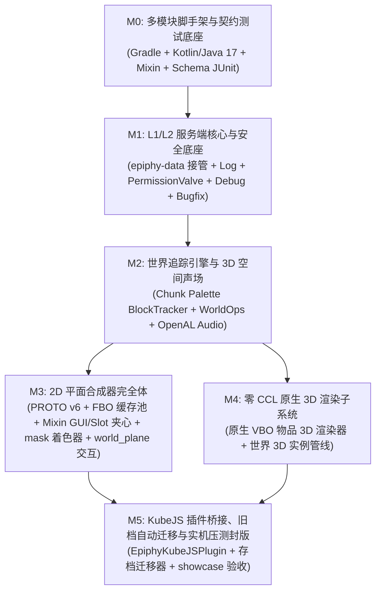

# Epiphy 独立原生模组（Kotlin + Java · Phase 4）迁移工程计划书

> **文档状态**：Phase 4 原生化工程蓝图与架构实施计划（v1.0）  
> **许可证声明 (License)**：本文件适用 RAL-1.6 (Reciprocal Attribution License 1.6 / 相互开源署名许可证 1.6)  
> **前置基线**：KubeJS 过渡期 `P0 ~ P3` 全量里程碑已封版（15 个通用组件、74/74 回归单测、[`docs/proto_v6_schema.json`](proto_v6_schema.json) `v6.3.0`）  
> **关联文档**：[`README-LLM.md`](../README-LLM.md) · [`docs/rendering-subsystem-roadmap.md`](rendering-subsystem-roadmap.md)

---

## 1. 迁移总目标、核心铁律与技术栈选型

随着 `P3-1`（`surface: 'world_plane'`）与 `P3-2`（`Epiphy3DFX` & `EpiphyItem3DRenderer`）双端闭环落地，Epiphy 在 KubeJS 原型验证阶段的全部架构探路与协议收敛均已完成。进入 **Phase 4（独立原生 Mod 阶段）** 的核心目标不是简单地将 JS 逐行翻译为 Kotlin/Java，而是**保留已验证的声明式契约与安全边界，彻底卸除 Rhino 解释器与第三方胶水限制，解锁原生字节码与 GPU 硬件级管线能力**。

### 1.1 三条不可动摇的工程铁律
1. **能力导向与零案例倒灌铁律**：严格遵循 **【通过什么（底层机制）➔ 能够达成什么（通用能力）➔ 下游案例（具象应用）】**。核心引擎模块（`epiphy-core`）只提供正交原语、协议调度、渲染管线与可扩展注册表，**物理严禁包含任何特定整合包道具、Boss 或测试玩法代码**。
2. **核心零强制第三方 Mod 前置铁律**：原生 Mod 本体除 `Minecraft 1.20.1`、`Forge 47.2+` 与 `Kotlin for Forge`（或内置 Jar-in-Jar Kotlin 运行时）外，**零强制第三方 Mod 前置**。KubeJS 阶段在物品 3D 渲染中临时借用的 `CodeChickenLib` 特例将在原生 Mod 中 **100% 移除并自主实现**；`ModernUI`、`Curios API`、`KubeJS` 全部降为编译期 `compileOnly` + 运行期 `ModList.get().isLoaded(...)` 物理隔离的可选软兼容桥接。
3. **语义收敛与历史包袱清零**：正式移除过渡期冻结的淘汰别名表（`DEPRECATED_DANMAKU_ALIASES`、`DEPRECATED_PRIORITY_ALIASES` 及冗余中文/旧版枚举），全模块冻结 **「1 主标准名 + 至多 1 显式官方别名」** 规范。

### 1.2 构建与语言分工选型
| 维度 | 选型方案 | 选型依据 |
| :--- | :--- | :--- |
| **目标平台** | `Minecraft 1.20.1` · `Forge 47.2.x`（预留 NeoForge 1.21 演进边界） | 与现有测试端及目标整合包生态 100% 对齐；网络、事件与渲染接口内部做薄层封装以便未来平滑演进至 NeoForge |
| **JDK 与映射** | `Java 17` + `ParchmentMC 1.20.1` + `ForgeGradle 6.x`（或 `ModDevGradle`） | 编译期 Mojmap + 参数名可读，发布构建自动重映射 SRG，彻底告别 KubeJS 阶段手动双探 `m_xxxx_` / `f_xxxx_` 的反射脆弱性 |
| **Kotlin + Java 混编分工** | **Kotlin (`1.9.24+` / `2.0`)**：声明式 Schema 数据类、`ui()`/`fx()` 类型安全 DSL、服务端调度状态机、权限域树、配置与 KubeJS 插件桥接<br>**Java 17**：全部 Mixin 类、OpenGL / `BufferBuilder` / VBO 紧凑字节流写入、每帧零装箱热路径矩阵运算 | 兼顾高层业务/DSL 的表达力与底层渲染热路径、Mixin 字节码织入的绝对确定性（零隐式装箱、零合成桥接签名冲突） |
| **字节码注入** | `SpongePowered Mixin 0.8.5` + `MixinExtras` | 以最小侵入度的 `@Inject` / `@WrapOperation` 解锁 KubeJS 阶段被阻塞的 `gui` 全屏夹心、`renderSlot` 槽位底层夹心、`GuiGraphics.blit` 贴图拦截与第三方物品 3D 挂载 |

---

## 2. 多模块 Gradle 工程与包结构切分

采用清晰的四子工程（Multi-Project Gradle）切分，从物理编译依赖上杜绝“业务案例污染引擎核心”或“可选联动 Mod 引发 `NoClassDefFoundError`”：

```text
epiphy-mod/
├── epiphy-api/               # 纯公共契约层（零内部实现耦合，供下游附属 Mod 或脚本插件依赖）
│   └── dev.epiphy.api.*      #   PROTO v6 / FX3D / Audio 数据模型、Preset/Widget/Shader 注册接口、类型安全 DSL
├── epiphy-core/              # 原生核心引擎本体（零强制第三方 Mod 前置，产出主模组 Jar）
│   ├── dev.epiphy.core.*     #   双端共享协议编解码、数学与有界 LRU/FIFO 缓存、预设中心
│   ├── dev.epiphy.server.*   #   epiphy-data 外置存储、权限阀、日志、调试中心、方块/区块引擎、2D/3D/音频服务端调度器、Bugfix
│   ├── dev.epiphy.client.*   #   2D 平面合成器 (+FBO池)、世界/物品原生 3D 渲染器 (零CCL)、3D 空间音频播放器
│   └── dev.epiphy.mixin.*    #   纯 Java Mixin（GUI/Slot 夹心、纹理重映射、第三方物品 3D 钩子）
├── epiphy-compat/            # 可选软兼容桥接层（全部 compileOnly，按 ModList 动态装配）
│   ├── compat.modernui.*     #   ModernUI TextLayoutEngine 直连排版与 SDF 单 Pass 描边快路径
│   ├── compat.curios.*       #   Curios API 饰品栏安全物品检索桥接
│   └── compat.kubejs.*       #   EpiphyKubeJSPlugin：向存量 KubeJS 脚本暴露兼容的 Epiphy* 绑定门面
└── epiphy-showcase/          # 可选独立案例与附属内容包（不打入核心发行 Jar，用于实机验收与魔改示范）
    └── dev.epiphy.showcase.* #   rnfmabj_test 测试方块、imperius_test 物品 3D 示范、失稳拆解台混沌殉爆迁移参考
```

---

## 3. 现行 15 个通用组件 ➔ 原生模块 1:1 映射与瘦身清单

| 现行 KubeJS 组件（封版版本） | 原生目标包路径 | 核心迁移策略 | 原生化可直接裁撤的历史补偿代码 |
| :--- | :--- | :--- | :--- |
| `EpiphySpec` (`v2.8.1`) | `dev.epiphy.api.spec`<br>`dev.epiphy.core.protocol` | 转为编译期不可变密封接口/数据类、网络 `FriendlyByteBuf` 编解码器、`BoundedCache<K,V>` 与全局 `PresetRegistry` | 裁撤 `NativeMath` 8 常量补丁、`safeTypeOf`、`nbtToPlainJs`、`DEPRECATED_*_ALIASES` |
| `EpiphyItem3DRenderer` (`v1.1.0`) | `dev.epiphy.client.fx3d.item` | **彻底去 CCL 原生重写**（见 §4.1）：`IClientItemExtensions` + `BEWLR` + `ItemRenderer` Mixin + 原生 GPU `VertexBuffer` (VBO) + 原版 `ShaderInstance` | 裁撤全部 `codechicken.lib.*` 反射绑定与 `CCModel`/`CCRenderState` 包装 |
| `EpiphyCreativeTab` (`v1.0.0`) | `dev.epiphy.core.registry` | 标准 Forge `DeferredRegister<CreativeModeTab>` + 事件动态追加接口 | 裁撤 KubeJS `StartupEvents.modifyCreativeTab` 字符串桥接 |
| `EpiphyLog` (`v1.3.0`) | `dev.epiphy.server.log` | 基于 SLF4J + 异步无锁 `Disruptor`/阻塞队列后台写盘线程，维护按世界路由的 `epiphy-data/worlds/<id>/logs/*.log` 与限频折叠 | 裁撤 `ClassFilter` `JsonIO`/`FilesIO` 写盘降级分支，直接使用 Java NIO `FileChannel` |
| `EpiphyServerCore` (`v2.6.0`) | `dev.epiphy.server.core`<br>`dev.epiphy.server.storage` | 保留 `JsonStore<T>`（Kotlin Serialization / Gson + `Files.move(ATOMIC_MOVE)` + `.bak` 自愈 + `corruptLocked` 隔离备份锁）与 `epiphy-data/` 世界防串档自动分叉机制 | 裁撤 `LinkedTreeMap` 手工递归转换、Mojmap/SRG 双路方法探测、手写 Brigadier 反射构建器（改用原生泛型 Brigadier DSL） |
| `EpiphyBlockTracker` (`v2.5.1`) | `dev.epiphy.server.world` | 升级为 `LevelChunk` Capability / `SavedData` + 区块加载/卸载事件直连（零反射读取 `LevelChunkSection.getStates()` Palette 快速剪枝）+ 三级门控 `WorldOps` 批处理队列 | 裁撤 KubeJS 兜底慢速逐点 `getBlock` 轮询 |
| `EpiphyPermissionValve` (`v5.4.0`) | `dev.epiphy.server.security` | 完整保留三态权限树（`grant`/`revoke`/`inherit`）、`exactScopeOnly` 广播门、命令方块防篡改锁、外置 `revocations.json` 防回滚墓碑与 8 位口令 2 分钟二次确认 `namegrant` | 裁撤 Rhino 调用栈字符串令牌伪造防御（改用 Java 模块级包私有句柄与强类型 `CommandSourceStack` 鉴权） |
| `EpiphyDebug` (`v1.1.0`) | `dev.epiphy.server.debug` | 原生 `DebugProvider` SPI 接口、JVM GC/堆内存与帧耗时遥测聚合、`/epiphy debug renderperf` S2C 采样控制 | 零裁剪平滑演进 |
| `EpiphyBugfix` (`v1.0.0`) | `dev.epiphy.server.bugfix` | 原生 `PlayerEvent.PlayerLoggedOutEvent` / `PlayerLoggedInEvent` + 玩家 Capability / `SavedData` 权威生命值上限保持与恢复 | 裁撤 NBT 文本手工读写 |
| `Epiphy2DSurface` (`v6.3.0`) | `dev.epiphy.server.surface2d` | 强类型 `SurfaceChannel` / `SurfaceSlot`、`ui {}` Kotlin DSL、`world_plane` `SavedData` 视距追踪器（基于服务端 ChunkMap 追踪集合替代全服玩家扫描） | 裁撤分组展平运行期拼写扫描（编译期类型检查直接根治拼写错误；仅在 JSON/KubeJS 入口保留 Schema 校验） |
| `Epiphy2DRenderer` (`v6.3.0`) | `dev.epiphy.client.surface2d` | 原生 `GuiGraphics` + GPU VBO/批处理合成器、**`TextureTarget` (FBO) 离屏缓存池**、Mixin 驱动 `gui`/`slot` 夹心、`fill.mask` 着色器、`world_plane` 3D 射线交互 | 裁撤 `PaintScreenEventJS` / `Painter` 桥接包装与 Rhino 数值拆装箱开销 |
| `Epiphy3DFXServer` (`v1.2.0`) | `dev.epiphy.server.fx3d` | 强类型空间特效调度器、`ConstraintPipeline`、`Channel`/`Slot` 增量 `patch` 与玩家层配额隔离 | 零裁剪平滑演进 |
| `Epiphy3DFX` (`v2.3.0`) | `dev.epiphy.client.fx3d.world` | 原生 `RenderLevelStageEvent` + 预烘焙几何模板 VBO（单位环/球/螺旋在 GPU 端实例化或矩阵变换）+ 自定义 Core/Post Shader 管线 | 裁撤逐帧三角函数重算顶点的解释器开销 |
| `EpiphyAudio` (`v5.8.0`) | `dev.epiphy.server.audio` | 空间声场句柄状态机、球簇合并 (`SphereMergeClusters`)、实体追踪与玩家层单向淘汰保护 | 零裁剪平滑演进 |
| `EpiphyAudioClient` (`v5.6.0`) | `dev.epiphy.client.audio` | 基于原版 `SoundEngine` / OpenAL `Channel` Accessor Mixin 的零反射 3D 声源实时坐标更新、暂停保流、温和 `minecraft:` BGM 避让与断流重连 | 裁撤 `SoundEngine` 私有字段运行期反射查找（改用编译期校验的 Mixin `@Accessor`） |

---

## 4. 核心技术攻坚方案（去依赖自主实现 & 突破 KubeJS 天花板）

### 4.1 彻底移除 `CodeChickenLib`：原生三维物品渲染管线设计
在 KubeJS 阶段，由于脚本无法覆写 Java `Item.initializeClient` 且 Rhino 逐顶点循环耗时高达 8~25ms，我们经审批临时借用了可选特例 `CodeChickenLib`（`IItemRenderer` + `CCShaderInstance` + `CCModel`）。进入原生 Mod 后，**连根拔除全部 CCL 依赖**，采用 100% 原版/Forge 标准机制自主实现：

1. **双轨无侵入挂载机制**：
   - **自有注册物品**：在 `Item.initializeClient(Consumer<IClientItemExtensions>)` 中返回共享的 `EpiphyItemBewlr`（继承 `BlockEntityWithoutLevelRenderer`），并在模型烘焙阶段通过自定义 `IGeometryLoader` 或 `BakedModelWrapper` 将 `isCustomRenderer()` 标记为 `true`；
   - **为任意原版/第三方物品动态挂载 3D 特效**：编写精简纯 Java Mixin `ItemRendererMixin`，在 `ItemRenderer.render(ItemStack, ItemDisplayContext, ...)` 中对命中 `EpiphyItem3DRegistry`（O(1) `IdentityHashMap<Item, CompiledItemFxSpec>` 查表，未命中物品仅 1 次指针判空零损耗）的物品先渲染原版基底 `BakedModel`，再紧接提交声明式 3D 特效图层。
2. **原生 `ShaderInstance` 与强类型 Uniform**：
   - 监听 `RegisterShadersEvent` 直接实例化原版 `net.minecraft.client.renderer.ShaderInstance`（如 `epiphy:epiphy_cosmos`、`epiphy:additive_glow`）；
   - 在着色器加载回调中一次性缓存 `Uniform` 引用（`EpiphyTime`、`EpiphyYawPitch`、`EpiphyGuiMode` 及用户通过 `registerShader` 声明的自定义 Uniform），每帧直接 `uniform.set(...)` 零字符串查找。
3. **原生预烘焙网格（`BakedQuadMesh` / GPU `VertexBuffer`）**：
   - 模型烘焙期（资源重载时）按声明式图层（`surface_overlay`、`ribbon_ring`、`ribbon_helix`、`sprite_cluster` 及注册的自定义部件）在 Java 侧一次性计算全部顶点坐标、UV、颜色与平滑法线，打包为连续紧凑的 `float[]` / 直接内存模板（或静态层直传 GPU `com.mojang.blaze3d.vertex.VertexBuffer`）；
   - 每帧仅在 Java 栈/线程局部复用 JOML `Matrix4f` 计算轨道旋转与呼吸缩放，直接推入 `VertexConsumer`（兼容 Iris/OptiFine 光影缓冲流）或绑定 VBO 绘制，预计单件复杂多层 3D 武器 CPU 耗时 **`< 0.08 ms`**（较 Rhino+CCL 再快 6~8 倍）。

### 4.2 解锁 Phase 2/3 受限渲染能力（Mixin + FBO + Mask Shader）
1. **`TextureTarget` (FBO) 按需离屏缓存池（`dev.epiphy.client.surface2d.fbo`）**：
   - 针对静态多行富文本弹幕与声明了 `cachePolicy = STATIC | SUBTREE_ON_PATCH` 的高复杂度 2D 复合面板（如数十节点的工业遥测框、常驻 `world_plane` 告示牌），按尺寸分桶借用 `com.mojang.blaze3d.pipeline.TextureTarget`（含透明 Alpha 通道，使用预乘 Alpha 混合 `GL_ONE, GL_ONE_MINUS_SRC_ALPHA` 解决半透明边缘黑边问题！）；
   - 仅在首次创建或收到 `action: 'patch'` 触发脏标记时重绘 FBO，其余帧直接向屏幕或 3D 世界平面发射 **1 个纹理 Quad**；面板销毁后 FBO 自动归还缓存池并在空闲超时后释放显存。
2. **全场景 `gui` / `slot` 精准夹心 Mixin（完结 `P2-1` & `P2-3`）**：
   - `AbstractContainerScreenMixin`：在 `renderBg` 之后、`renderSlot` 循环之前注入 `gui.bgNodes`；在 `renderSlot` 内部绘制物品模型前注入 `slot.underlayNodes`、绘制物品数量叠字后注入 `slot.overlayNodes`；在全部槽位之后、`renderTooltip` 之前注入 `gui.fgNodes`；
   - `GuiGraphicsMixin`：在 `innerBlit(ResourceLocation, ...)` 入口对当前活跃会话的 `replaceTextures` Map 做 O(1) 重定向，彻底告别修改全局 `TextureManager` 状态，异常/关界面零残留风险。
3. **`fill.mode = 'mask'` 双采样器蒙版着色器**：
   - 新增原生核心着色器 `epiphy:ui_masked_fill`，同时采样 `Sampler0`（基底纯色/渐变/视差图层）与 `Sampler1`（任意异形 PNG 灰度/Alpha 遮罩），单 Pass 实现斜切装甲槽、圆环进度扇区与异形裂隙窗。
4. **`world_plane` 三维射线平面求交与轻交互**：
   - 对开启 `interactive = true` 的 `world_plane`，在客户端准星射线（`Player.pick` 视线向量）与平面方程 $(P - P_0) \cdot \vec{n} = 0$ 求交，反解局部像素坐标 $(u, v)$，支持节点悬停高亮（`$hover` 内置变量）与右键点击事件回传服务端（附带服务端距离 `<= maxDistance` 与视线防穿墙二次校验）。

---

## 5. 网络协议、双轨持久化继承与 KubeJS 平滑过渡桥接

### 5.1 网络层：二进制帧极速传输 + JSON Schema 100% 契约兼容
- **通道划分**：基于 Forge `NetworkRegistry.newSimpleChannel` 建立 `epiphy:main` 多路复用协议通道（协议主版本管理，客户端连接时自动握手校验）；
- **紧凑二进制序列化**：保留 [`docs/proto_v6_schema.json`](proto_v6_schema.json) 的全部逻辑字段语义，但在网络线上不再走冗长的 `CompoundTag` 键值对，而是用 `FriendlyByteBuf` 按位掩码（BitMask）仅编码非默认字段（高频 `action: 'patch'` 心跳包体积从数百字节压缩至 **`18 ~ 32 Bytes`**！）。

### 5.2 存储层：严守「随档回滚 vs 外置抗回滚」数据边界与自动迁移
完全继承 [`README-LLM.md`](../README-LLM.md) §5.1 确立的双轨数据边界，并提供**旧存档首次启动自动无损迁移**：

| 数据类别 | KubeJS 阶段位置 | 原生 Mod 阶段位置 | 自动迁移策略 |
| :--- | :--- | :--- | :--- |
| **随存档同步回滚的世界状态**<br>（方块追踪表、`world_plane` 全息牌、退出 HP 恢复、事件倒计时） | `saves/<world>/kubejs_epiphy_tracked_blocks.json`<br>`saves/<world>/kubejs_epiphy_world_planes.json`<br>`persistentData` | 原版维度/世界级 `SavedData` (`data/epiphy_*.dat`) 或 `saves/<world>/epiphy/*.json` | 世界加载时若新存储为空且检测到旧 `kubejs_epiphy_*.json`，自动解析导入新存储并将旧文件重命名为 `.migrated_to_mod.bak` |
| **抗回滚安全、审计与跨档索引**<br>（权限阀授权、`revocations.json` 墓碑、`auth_mode.json`、`worlds_index.json`、外部运行日志） | `<gameDir>/epiphy-data/` | **原路径原格式 100% 保留 `<gameDir>/epiphy-data/`** | 零迁移损耗直接无缝接管！原权限授权、撤销墓碑与世界分叉记录在升级为原生 Mod 后开箱即用 |

### 5.3 `EpiphyKubeJSPlugin`：存量魔改脚本零痛感过渡
当整合包同时安装了 `KubeJS` 时，`epiphy-compat` 中的 `EpiphyKubeJSPlugin` 自动激活：
- 通过 `registerBindings` 直接注入底层由原生 Kotlin/Java 驱动的 `EpiphySpec`、`EpiphyServerCore`、`EpiphyBlockTracker`、`EpiphyWorldOps`、`EpiphyPermissionValve`、`Epiphy2DSurface` (`ScreenDanmaku`)、`Epiphy2DRenderer` (`ScreenDanmakuClient`)、`Epiphy3DFXServer`、`Epiphy3DFX`、`EpiphyItem3DRenderer` 与 `EpiphyAudio`；
- 这意味着整合包作者既可以用**原生 Kotlin/Java API** 编写高性能核心机制，也可以继续用简短的 **KubeJS 脚本** 调用 `Epiphy2DSurface.spawnWorldPlane(...)` 或注册预设，享受原生 C++/GPU 级渲染性能而无需一次性重写全部整合包魔改脚本。

---

## 6. 分里程碑实施路线图（Milestones M0 ~ M5）



| 里程碑 | 核心交付物 | 关键验收门禁（Definition of Done） |
| :--- | :--- | :--- |
| **M0：工程脚手架与契约基座** | 建立四模块 Gradle 工程（`api`/`core`/`compat`/`showcase`）；接入 Parchment 与 Mixin；在 `epiphy-api` 落地 `proto_v6_schema.json` 跨语言契约校验单测 | `./gradlew check` 全绿；不装任何第三方 Mod 启动纯净 Forge 1.20.1 客户端与专用服务端（Dedicated Server）零崩溃、零客户端类泄漏 |
| **M1：核心存储与权限安全底座** | 完成 `JsonStore`、`epiphy-data/` 世界自动分叉、`EpiphyLog` 异步写盘、`EpiphyPermissionValve`（三态域 + 墓碑 + 二次口令确认）、`EpiphyDebug` 与 `EpiphyBugfix` | 100% 复现并通过现行权限阀防提权、防回滚墓碑、损坏文件 `.corrupt.bak` 隔离锁 JUnit 测试；直接读取现有测试端 `epiphy-data/` 零报错兼容 |
| **M2：方块/区块引擎与空间音频** | 完成基于 `LevelChunkSection` Palette 直读的 `BlockTracker`、三级门控 `WorldOps` 地形/流体批处理，以及基于 Mixin `@Accessor` 的双端 `EpiphyAudio` 3D 声场与温和 BGM 避让 | 1000+ 绑定方块区块扫描耗时 `< 0.5ms/tick`；ESC 暂停/失焦恢复、球簇合并与非 `minecraft:` 模组音乐零误停测试通过 |
| **M3：2D 平面合成器完全体** | 完成 `PROTO v6` 全部 6 类图元、混合图文全富文本 Pass-Grouped 合批（完结 `P1-2`）、`TextureTarget` FBO 池、`AbstractContainerScreen` & `GuiGraphics` 夹心 Mixin（完结 `P2-1`/`P2-3`）、`fill.mask` 着色器与 `world_plane` 射线交互 | 20 条并发弹幕 + 2 个复杂遥测面板 + 54 槽位动态覆盖层同屏总 CPU/GPU 提交耗时 **`<= 0.4 ms`**；开闭任意 GUI 贴图与 OpenGL 状态 100% 零泄漏 |
| **M4：零 CCL 原生 3D 子系统** | 完成 `EpiphyItem3DRenderer` 原生 VBO + `ShaderInstance` + `IClientItemExtensions`/`ItemRendererMixin` 实现（**彻底删除 CCL**），以及 `Epiphy3DFX` 世界 3D 特效渲染器 | 在**未安装 CodeChickenLib** 的纯净 Forge 客户端中，多层自定义着色器 + 星环/螺旋/粒子簇三维物品在第一/三人称与 GUI 槽位中完美渲染，零穿模、单件耗时 `< 0.08ms` |
| **M5：兼容桥接、存档迁移与封版** | 完成 `EpiphyKubeJSPlugin`、`ModernUI`/`Curios` 软兼容隔离模块、旧存档 `kubejs_epiphy_*.json` 自动迁移器，并在 `epiphy-showcase` 完整跑通 `v18` 混沌殉爆与测试套件 | 旧测试存档升级加载后世界平面与追踪方块 100% 自动无损恢复；卸载 KubeJS/ModernUI/Curios 任一组合均正常启动运行；Dedicated Server 压力回归通过 |

---

## 7. 关键技术风险与前置防控矩阵

| 潜在风险点 | 风险等级 | 前置工程防控措施 |
| :--- | :---: | :--- |
| **1. 专用服务端（Dedicated Server）误加载客户端类 (`DistExecutor` / `@OnlyIn` 崩溃)** | 高 | 严禁在双端共享数据类或包内直接引用 `Minecraft`、`PoseStack`、`ShaderInstance`、`VertexBuffer`；客户端逻辑全部收拢于 `dev.epiphy.client.*` 并仅通过 `FMLEnvironment.dist == Dist.CLIENT` 隔离入口注册；M0 即配置 Gradle `runServer` 自动化冒烟门禁。 |
| **2. FBO 离屏缓存半透明文本/图元二次混合发黑（Alpha 衰减失真）** | 中高 | 向 `TextureTarget` 离屏绘制时写入预乘 Alpha（Premultiplied Alpha），将 FBO 贴回主屏幕或 3D 世界平面时固定使用 `RenderSystem.blendFunc(GL_ONE, GL_ONE_MINUS_SRC_ALPHA)`，绘制完毕在 `finally` 中恢复标准混合方程。 |
| **3. Iris / OptiFine 光影管线与自定义 Core Shader / Mixin 冲突** | 中高 | 物品与世界 3D 优先通过标准 `MultiBufferSource` 管线与 `RenderLevelStageEvent.Stage.AFTER_TRANSLUCENT_BLOCKS` 提交；当探测到活跃光影接管且自定义 Core Shader 被拦截时，复用已验证的 Fail-Soft 降级矩阵平滑退回标准发光贴图通道。 |
| **4. 可选联动 Mod（KubeJS / ModernUI / Curios）未安装时引发类验证错误** | 中 | 所有可选联动代码物理隔离在独立包 `dev.epiphy.compat.<modid>.*`，主模块仅在确认 `ModList.get().isLoaded("<modid>")` 为 `true` 后通过反射或独立工厂类触发类加载，并在 CI 分别运行“全装联动”与“零联动纯净”两套启动测试。 |
| **5. Kotlin 隐式装箱或 Lambda 分配污染每帧渲染热路径** | 低中 | 底层顶点发射、矩阵栈变换、字素查表与 Mixin 类强制使用纯 Java 17 或 Kotlin 基本类型数组（`FloatArray` / `IntArray`）+ `inline` 函数，通过 JFR (Java Flight Recorder) 监控确保稳定态渲染热路径每帧堆分配趋近于 `0 Bytes`。 |
